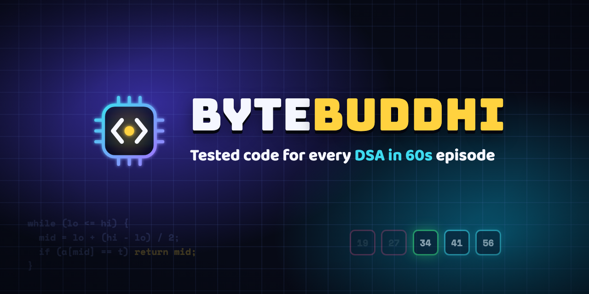

<p align="center"></p>

<p align="center">
  <a href="https://github.com/bytebuddhi22/dsa-in-60s/actions/workflows/tests.yml"></a>
  <a href="https://www.youtube.com/@ByteBuddhi"></a>
  <a href="https://www.instagram.com/bytebuddhi/"></a>
  <a href="https://discord.gg/55pd9C2zAE"></a>
</p>

# DSA in 60s

**Byte-sized DSA, Hinglish mein.** One data-structures & algorithms concept per 60-second video, and here is the
code for every one of them: the exact C++ from the video, a Python version, and tests that prove both work.

## Episodes

| # | Topic | The idea in one line | Time | Code |
|---|---|---|---|---|
| 01 | [Binary Search](01-binary-search) | Look at the middle, throw away half | O(log n) | [C++](01-binary-search/binary_search.cpp) · [Python](01-binary-search/binary_search.py) |
| 02 | [Two Pointers](02-two-pointers) | Sum too big → right--, too small → left++ | O(n) | [C++](02-two-pointers/two_pointers.cpp) · [Python](02-two-pointers/two_pointers.py) |
| 03 | [Sliding Window](03-sliding-window) | One out, one in: don't re-add the whole window | O(n) | [C++](03-sliding-window/sliding_window.cpp) · [Python](03-sliding-window/sliding_window.py) |
| 04 | [Prefix Sum](04-prefix-sum) | Build once, answer any range sum in one step | O(n) + O(1)/query | [C++](04-prefix-sum/prefix_sum.cpp) · [Python](04-prefix-sum/prefix_sum.py) |
| 05 | [Stack](05-stack) | Opening → push, closing → must match the top | O(n) | [C++](05-stack/valid_parentheses.cpp) · [Python](05-stack/valid_parentheses.py) |
| 06 | [Recursion](06-recursion) | Big problem = same problem, a bit smaller + a base case | O(n) | [C++](06-recursion/recursion.cpp) · [Python](06-recursion/recursion.py) |
| 07 | [Hashing](07-hashing) | Ask "what do I need?" and look it up in O(1) | O(n) | [C++](07-hashing/two_sum.cpp) · [Python](07-hashing/two_sum.py) |
| 08 | [Linked List](08-linked-list) | Insert = change 2 pointers, nothing shifts | O(1) insert | [C++](08-linked-list/linked_list.cpp) · [Python](08-linked-list/linked_list.py) |

Next up: **Queue**. Subscribe so you don't miss it.

## Run it yourself

```bash
git clone https://github.com/bytebuddhi22/dsa-in-60s.git
cd dsa-in-60s
./run_tests.sh                      # every episode, C++ and Python

g++ -std=c++17 01-binary-search/binary_search.cpp -o bs && ./bs   # one C++ demo
python3 01-binary-search/binary_search.py                         # one Python demo
```

Needs `g++` (C++17) and Python 3. Every C++ file compiles with `-Wall -Wextra -Werror`, and each episode is tested
against a brute-force answer on thousands of random inputs.

## Found a bug or have a doubt?

Open an [issue](https://github.com/bytebuddhi22/dsa-in-60s/issues), or ask in **#doubts** on
[Discord](https://discord.gg/55pd9C2zAE).

MIT licensed, so use it however you like. ⭐ the repo if it helped you.
